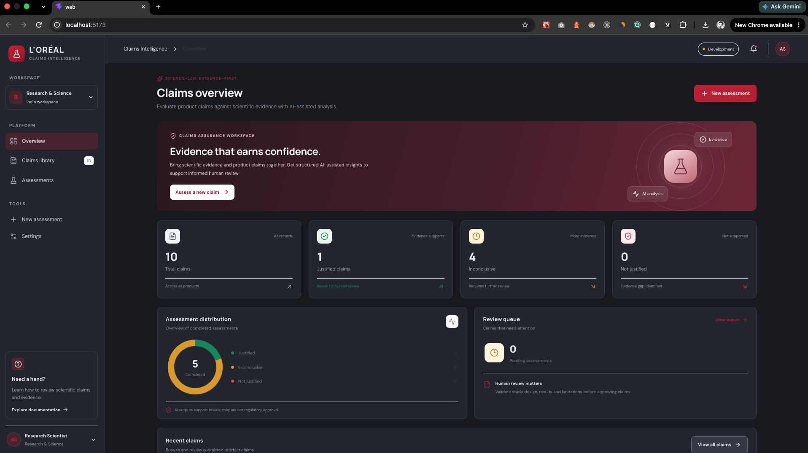
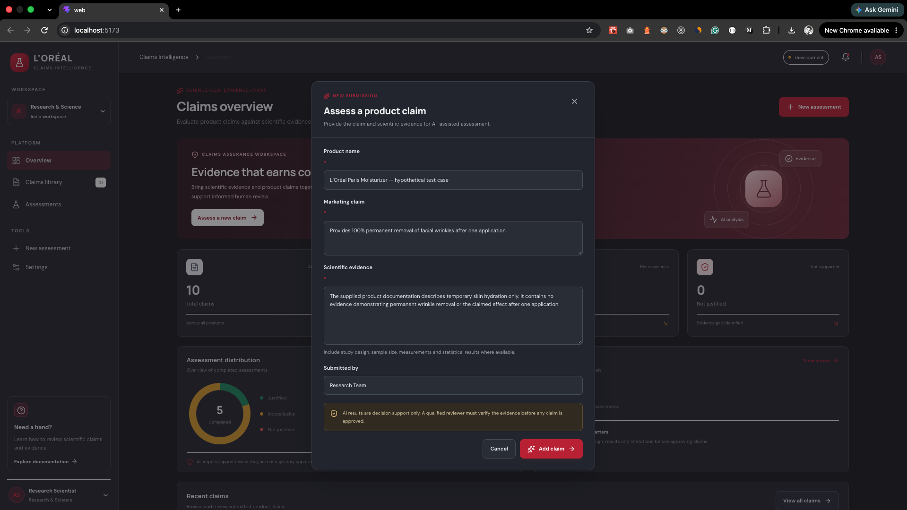
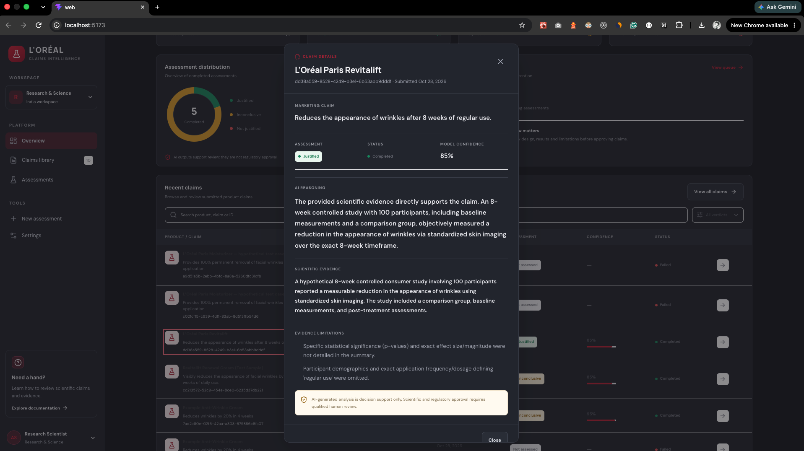
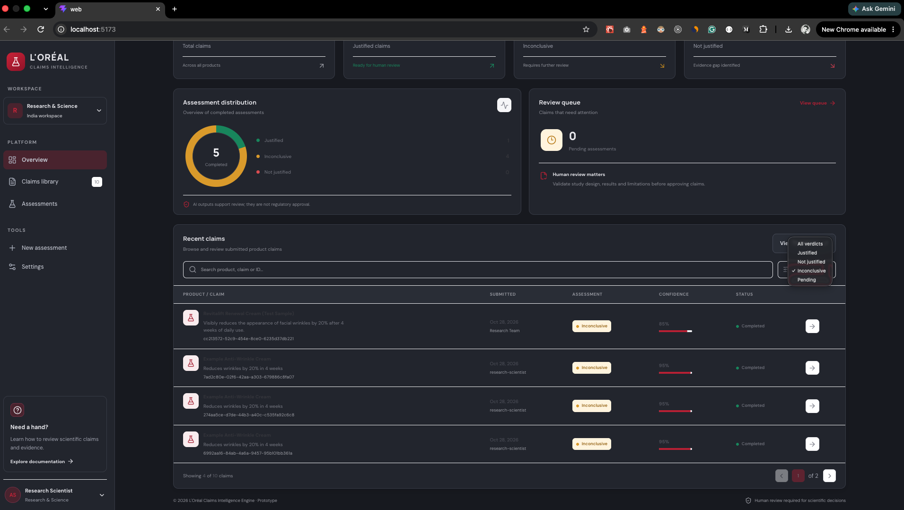
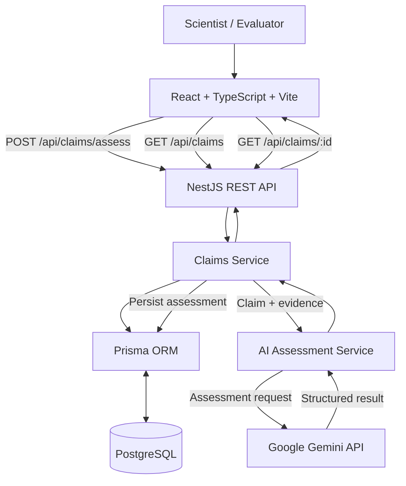
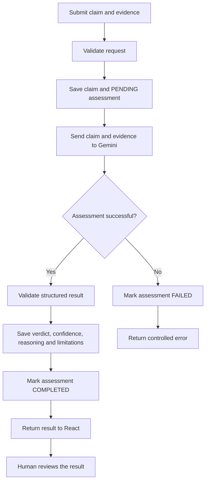

# L'Oréal Claims Intelligence Engine

An AI-assisted full-stack prototype for assessing whether scientific evidence supports cosmetic product claims. The application combines a React dashboard, a NestJS REST API, Prisma, PostgreSQL, and Google Gemini to produce structured assessment results for human review.

> **Important:** AI assessments are decision support only. They are not independent scientific verification, product efficacy certification, or regulatory approval. A qualified human reviewer must verify the evidence before making a decision.

## Screenshots

### Dashboard



### New claim submission



### Assessment result



### Search, filters, and pagination



## Business Workflow

The business process represented by the prototype is:

1. **Business Team** proposes a product and marketing claims.
2. **Claim Manager** reviews applicability and feasibility.
3. **Research & Innovation (R&I) Scientist** develops the product formulation.
4. **Evaluator** conducts or reviews relevant tests and submits scientific evidence.
5. **Claims Intelligence Engine** assesses the supplied evidence against the claim.
6. The result is stored and presented for **human review**.

The prototype focuses on the claim-and-evidence assessment workflow and its persistence and user interface.

## Core Features

- Submit a product name, marketing claim, scientific evidence, and submitter details.
- Generate a structured AI-assisted assessment.
- Return one of three verdicts:
  - `JUSTIFIED`
  - `NOT_JUSTIFIED`
  - `INCONCLUSIVE`
- Display an estimated confidence score, reasoning, and evidence limitations.
- Persist claims and assessment records in PostgreSQL.
- Retain assessment status and relevant model metadata.
- View claim details and assessment history.
- Search claims, filter by verdict/status, and navigate paginated results.
- Handle assessment failures and communicate controlled errors to the UI.
- Display a human-review disclaimer.

## Technology Stack

| Layer                | Technology                          |
| -------------------- | ----------------------------------- |
| Frontend             | React, TypeScript, Vite             |
| Backend              | NestJS, TypeScript                  |
| API style            | REST / JSON                         |
| Database             | PostgreSQL                          |
| ORM                  | Prisma                              |
| AI provider          | Google Gemini API (`@google/genai`) |
| Package management   | pnpm workspaces                     |
| Local infrastructure | Docker Compose, where configured    |
| Version control      | Git                                 |

## Architecture

The application is organized as a monorepo with a React frontend and a NestJS API.



### Assessment Lifecycle



The synchronous assessment endpoint waits for the AI request to complete before returning the final result. Provider latency can therefore affect submission time.

## Data Model

The Prisma schema defines two primary entities:

### `Claim`

Stores the product name, marketing claim/description, submitter, timestamps, and relationship to assessment records.

### `Assessment`

Stores the claim reference, evidence snapshot, verdict, confidence score, reasoning, limitations, status, model/prompt metadata, and creation/completion timestamps.

A claim can have multiple assessment records so assessment history can be retained.

## API

The API is served under the `/api` prefix.

| Method | Endpoint             | Purpose                                                                                |
| ------ | -------------------- | -------------------------------------------------------------------------------------- |
| `POST` | `/api/claims/assess` | Save a claim and evidence, request an AI assessment, persist the result, and return it |
| `GET`  | `/api/claims`        | Retrieve paginated claims; supports search and verdict/status filtering                |
| `GET`  | `/api/claims/:id`    | Retrieve a claim and its assessment details                                            |

### Example assessment request

```json
{
  "productName": "L'Oréal Paris Revitalift",
  "claim": "Reduces the appearance of wrinkles after 8 weeks of regular use.",
  "evidence": "Provide the scientific study design, sample size, measurements, results, and limitations.",
  "submittedBy": "Evaluator"
}
```

The assessment response includes the claim and assessment identifiers, status, verdict, confidence score, reasoning, limitations, and a message. Exact fields depend on the API response type.

## Getting Started

### Prerequisites

- Node.js version compatible with the repository's `package.json` and lockfile
- pnpm
- PostgreSQL, either locally or through the repository's Docker Compose setup
- A Google Gemini API key for live AI assessment

### 1. Clone the repository

```bash
git clone <your-repository-url>
cd loreal-claims-intelligence-engine
```

### 2. Install dependencies

```bash
pnpm install
```

### 3. Configure environment variables

Configure the backend environment with the database connection string and Gemini API key. Keep credentials in local environment files and never commit real secrets.

The frontend uses `VITE_API_BASE_URL` to identify the API base URL. For local development, the configured value used by the application is:

```dotenv
VITE_API_BASE_URL=http://localhost:3000/api
```

The backend's API prefix is `/api` and its development server is configured for port `3000`; the frontend development server commonly runs on port `5173`.

Use the variable names expected by the current API `.env` configuration. Do not expose `GEMINI_API_KEY` through any `VITE_` variable or frontend code.

### 4. Set up the database

Start PostgreSQL using the method configured for your environment. Apply the Prisma migrations using the repository's configured Prisma scripts or the appropriate command from `apps/api`.

For example, in a development setup where Prisma CLI is available in the API workspace:

```bash
pnpm --dir apps/api exec prisma migrate dev
```

Check the repository's `package.json` scripts and Prisma configuration before running database commands.

### 5. Start the applications

Use the root scripts documented in `package.json` if available. In a workspace without a root development script, start the API and web app from separate terminals using their respective workspace scripts.

Check the scripts in:

- `package.json`
- `apps/api/package.json`
- `apps/web/package.json`

This avoids relying on commands that may differ between local configurations.

## Configuration and Security

- Keep `GEMINI_API_KEY` on the backend only.
- Do not commit `.env` files or credentials.
- Validate request input and structured AI output.
- Treat evidence text as untrusted input.
- Avoid logging sensitive study content unnecessarily.
- Use bounded timeouts and suitable failure handling for external API calls.
- Do not treat the LLM-generated confidence score as a statistically calibrated probability.
- Require qualified human review before scientific or regulatory decisions.

## Testing and Verification

Before submission, verify the following manually or through automated tests:

- Submit a claim with evidence and confirm the API returns a result or a controlled error.
- Confirm the claim and assessment are persisted in PostgreSQL.
- Open a claim detail view and check the saved evidence and assessment result.
- Search for a claim that is not on the first page.
- Test verdict/status filters and pagination.
- Test missing or invalid request fields.
- Test provider failures and confirm the UI leaves the loading state.
- Run the frontend and backend build/test scripts available in the repository.

## Research and Technical Decisions

- **Modular monolith:** a single NestJS API is simpler to build and run within the one-day assessment window than a microservice deployment, while still keeping responsibilities separated.
- **React + TypeScript:** supports a typed, interactive dashboard and clearer API contracts.
- **NestJS:** provides a modular structure for controllers, services, validation, and error handling.
- **Prisma + PostgreSQL:** provides typed database access and a relational model for claims and multiple assessments.
- **Dedicated AI service:** isolates provider-specific code so it can be mocked in tests or replaced later.
- **Structured AI output:** makes it easier for the backend to validate and display a consistent result.
- **Human-in-the-loop review:** prevents the prototype's AI output from being mistaken for final scientific or regulatory approval.

The assignment brief mentions the OpenAI API as an example/provider requirement, while this implementation currently uses Google Gemini. This provider difference should be made explicit to the reviewer; the dedicated AI service helps keep a future provider change localized.

## Limitations

- The AI assessment may be slow or unavailable depending on provider response times.
- Model output may be inaccurate, incomplete, or inconsistent.
- The assessment is only as useful as the evidence supplied.
- The confidence score is an LLM-generated assessment score, not a calibrated probability.
- The current endpoint waits synchronously for the AI result.
- Enterprise authentication, role-based access control, and production deployment hardening are not represented as completed features.

## Future Roadmap

1. **Reliability:** background assessment jobs, bounded retries, request correlation IDs, and clearer recovery for failed persistence.
2. **Evidence ingestion:** PDF upload, text extraction, page-level citations, and evidence traceability.
3. **Scientific evaluation:** study metadata, quality checks, stronger claim-to-evidence mapping, and evaluation datasets.
4. **Governance:** reviewer approvals, audit trails, model/prompt versioning, and reproducible assessments.
5. **Enterprise readiness:** authentication, role-based access control, rate limiting, monitoring, CI/CD, and deployment automation.
6. **Provider evaluation:** benchmark supported LLM providers on latency, structured-output reliability, cost, and assessment quality.

## Documentation

- [Product Requirements Document](docs/PRD.md)
- [Technical Architecture](docs/ARCHITECTURE.md)
