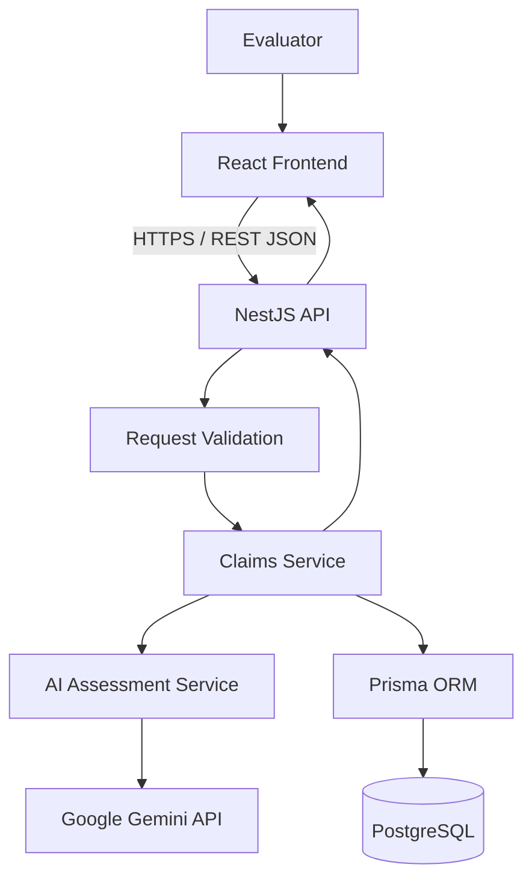
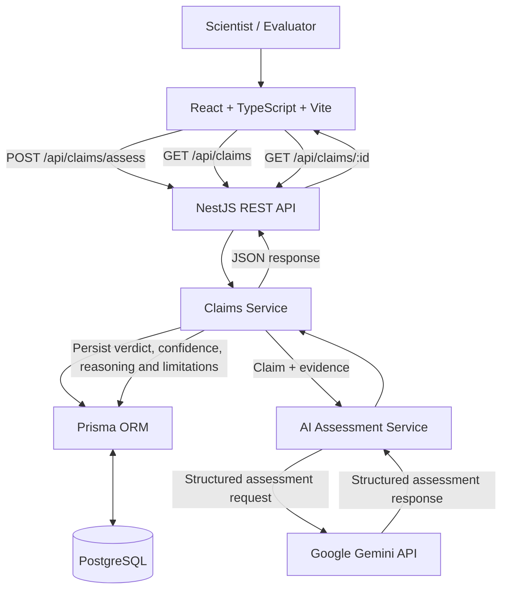
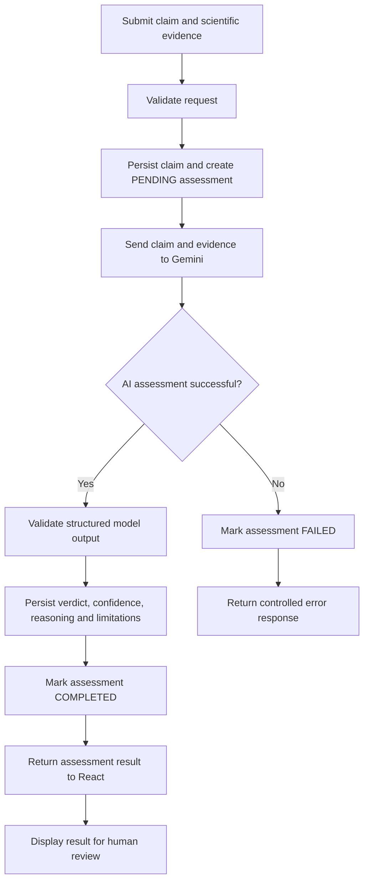

# Technical Architecture

## 1. Purpose

This document describes the proposed architecture for the L'Oréal Claims Intelligence Engine prototype.

The design prioritizes a working end-to-end workflow, clear separation of responsibilities, testability, and maintainability within a one-day assessment window.

## 2. Architecture Overview

The application uses a monorepo containing a React frontend and a NestJS backend.

The diagram describes the intended request flow. Implementation details may evolve as error handling and persistence are finalized.

## 3. Application Components

### 3.1 Frontend

Technology: React, TypeScript, Vite.

Responsibilities:

- Capture the product name, claim, and study evidence.
- Validate required fields before submission.
- Call the assessment API.
- Display the verdict, confidence estimate, reasoning, and limitations.
- Provide loading, validation, success, and error states.

### 3.2 Backend API

Technology: NestJS.

Responsibilities:

- Expose `POST /api/claims/assess`.
- Validate and normalize incoming data.
- Coordinate claim and assessment persistence.
- Invoke the AI assessment service.
- Validate model output.
- Return consistent responses and handle failures safely.

### 3.3 AI Assessment Service

Technology: Google Gemini API through the official Google Gen AI SDK.

Responsibilities:

- Construct a structured assessment request.
- Supply the claim and relevant scientific evidence to the model.
- Request a schema-constrained response where supported.
- Validate the response before it reaches persistence.
- Handle timeouts, provider errors, and malformed results.

The AI integration should be isolated behind a service interface so that another provider or a mock implementation can be substituted without changing the controller.

### 3.4 Persistence Layer

Technology: Prisma and PostgreSQL.

The initial data model contains two primary entities.

**Claim**

Stores the product claim, optional product information, timestamps, and the relationship to its assessments.

**Assessment**

Stores the evidence snapshot, verdict, confidence estimate, reasoning, limitations, status, model metadata, and creation/completion timestamps.

One claim may have multiple assessments to preserve the history of evaluations.

## 4. Request Lifecycle

1. The evaluator submits a claim and study evidence from the frontend.
2. The NestJS controller validates the request.
3. The claims service creates or identifies the claim and manages the assessment lifecycle.
4. The AI service submits the evidence for evaluation.
5. The response is validated against the expected output schema.
6. The assessment is persisted with its evidence and model metadata.
7. The API returns the persisted result to the frontend.
8. The frontend renders the verdict and supporting explanation.

The implementation must explicitly handle failures before and after the AI call, including cases where the AI succeeds but persistence fails.

## 5. Assessment Outcomes

The proposed verdicts are:

- `JUSTIFIED`: The supplied evidence sufficiently supports the claim under the defined assessment criteria.
- `NOT_JUSTIFIED`: The evidence does not support the claim, or materially contradicts it.
- `INCONCLUSIVE`: The available evidence is insufficient or ambiguous.

An inconclusive outcome is important because missing information should not be converted into an unsupported positive or negative conclusion.

## 6. Security and Reliability

- Keep API keys and database credentials on the server.
- Exclude secrets from Git and provide an example environment file.
- Validate request fields and limit request sizes.
- Avoid logging raw sensitive study data unnecessarily.
- Treat uploaded documents and evidence as untrusted input.
- Validate model output before using it.
- Set timeouts and bounded retry policies for external requests.
- Preserve assessment status and failure information where appropriate.
- Require human review before scientific or regulatory decisions.

## 7. Architectural Decisions

### Modular monolith

A single NestJS application is appropriate for the prototype. It avoids the operational overhead of microservices while keeping claims, persistence, and AI integration logically separated.

### PostgreSQL and Prisma

A relational database supports the relationship between claims and multiple assessments. Prisma provides typed database access and versioned schema migrations.

### AI provider abstraction

Keeping Gemini-specific code in a dedicated service reduces coupling and makes testing, provider substitution, and future evaluation easier.

### Docker Compose

Docker Compose will provide a reproducible local environment for PostgreSQL and, where practical, the frontend and backend.

### Monorepo

The frontend, backend, shared contracts, and documentation live in one repository. This simplifies setup and keeps changes to API contracts coordinated.

## 8. Testing Strategy

- Unit tests for request validation and business logic.
- AI service tests using a mocked provider.
- Integration tests for database persistence.
- API tests for success and failure scenarios.
- Frontend tests for form submission and result rendering.
- An end-to-end test covering the assessment workflow.

## 9. Future Evolution

Potential extensions include PDF ingestion, evidence extraction and citation tracking, evaluator approval workflows, authentication and role-based access control, audit trails, monitoring, multilingual support, and integration with enterprise research systems.

These capabilities are future roadmap items rather than requirements for the initial prototype.

## 10. Detailed Architecture and Assessment Lifecycle Diagrams

The following diagrams supplement the existing architecture overview above. The original diagram and all existing sections have been retained.

### 10.1 End-to-End System Architecture

**Flow summary**

- **React frontend:** collects submissions and presents claims, assessment results, search, filters, and pagination.
- **NestJS REST API:** validates requests and coordinates the claim and assessment workflow.
- **Claims service:** persists the claim and evidence, calls the AI assessment service, and stores the assessment outcome.
- **Prisma ORM and PostgreSQL:** persist claims and assessment history.
- **AI assessment service:** sends the claim and evidence to Google Gemini and validates the structured response.
- **Human evaluator:** reviews the AI-generated decision support; the result is not scientific or regulatory approval.

The endpoint paths shown above reflect the current API routes. The assessment endpoint waits for the AI assessment to complete before returning its result.

### 10.2 Assessment Request Lifecycle

**Lifecycle notes**

1. The frontend submits the product name, claim, evidence, and submitter details.
2. The backend validates the request and saves the claim plus an assessment in `PENDING` status.
3. The AI assessment service sends the claim and evidence to Gemini.
4. The backend validates the structured AI response before saving it.
5. On success, the assessment is updated with its verdict, confidence score, reasoning, limitations, model metadata, and completion timestamp, then marked `COMPLETED`.
6. If the AI assessment fails, the backend attempts to mark the assessment `FAILED` and returns a controlled error response.
7. The frontend displays the result when successful. A qualified human reviewer remains responsible for the final decision.

**Reliability consideration:** if the AI call succeeds but saving the result fails, the system must not present the assessment as successfully persisted. The assessment record should be checked and reconciled before a retry to avoid accidental duplicate submissions.
